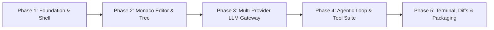

# AI Workflow Rules: Ty-Code

## Phased Implementation Roadmap

To ensure maintainability, rapid iteration, and high software quality, development is organized into 5 phased milestones:

### Phase 1: Foundation & Electron Shell
- Set up Vite + Electron + TypeScript scaffold with React 18/19.
- Configure secure IPC bridge (`contextBridge`, `contextIsolation: true`, strict CSP headers).
- Configure window controls, menu system, and `safeStorage` credential encryption.
- Establish theme variables and layout containers (Activity Bar, Sidebar, Editor, Panel, Sidecar).

### Phase 2: Monaco Editor & Workspace Management
- Integrate `@monaco-editor/react` with custom themes (VS Code Dark+ / Monokai / Cyberpunk).
- Implement multi-file tabs: active tab, dirty indicator, file save/auto-save, close tabs.
- Implement project file tree with icons, folder expand/collapse, file selection, and `.gitignore` awareness.
- Implement file watcher (`chokidar` or native Node `fs.watch`) to keep editor models synchronized with disk.

### Phase 3: Multi-Provider LLM Gateway (`free-claude-code` Architectural Model)
- Build unified provider client abstraction (`BaseProvider` interface).
- Implement OpenRouter adapter (supporting free tiers and low-cost models: DeepSeek, Qwen, Llama).
- Implement Groq, DeepSeek, and NVIDIA NIM direct API adapters.
- Implement Local Ollama / LM Studio adapter (automatic endpoint discovery at `http://127.0.0.1:11434`).
- Implement streaming Server-Sent Events (SSE) parser with token-by-token UI updates and tool-calling extraction.

### Phase 4: Agentic Coding Loop & Tool Execution Engine
- Implement the autonomous agent loop: prompt -> model call -> tool execution -> feedback loop -> termination.
- Build the core tool suite:
  - `read_file`: Read entire file or slice range with line numbers.
  - `write_file`: Atomic file creation / overwrite.
  - `replace_file_content`: Exact matching chunk replacement with collision detection.
  - `run_command`: Child process execution with timeout, stream buffering, and exit code capture.
  - `list_dir`: Recursive and non-recursive directory scan.
  - `grep_search`: Fast text search across files.
- Build visual Diff Review system using Monaco Diff Editor (`original` vs `modified` models).
- Add user approval modal for file changes and shell execution.

### Phase 5: Terminal, Polish, & Cross-Platform Packaging
- Integrate `xterm.js` with `node-pty` in an expandable bottom drawer.
- Add user settings panel: model switcher, API key management, custom system prompts.
- Polish animations, split-pane resizers, keyboard shortcuts (`Ctrl/Cmd+P`, `Ctrl/Cmd+Shift+P`, `Ctrl+\``).
- Package cross-platform production builds with `electron-builder` (`.exe`, `.dmg`, `.AppImage`).

---

## Security & Isolation Rules

1. **Strict Sandboxing**:
   - `webPreferences.nodeIntegration = false`
   - `webPreferences.contextIsolation = true`
   - `webPreferences.sandbox = true`
2. **Path Traversal Protection**:
   - All file operations initiated by the AI agent or renderer must resolve against the active workspace root.
   - Any attempt to access paths outside the workspace root (e.g., `../../Windows/System32` or `/etc/passwd`) must be immediately blocked and flagged with an error.
3. **Command Execution Guardrails**:
   - Blacklist or require explicit confirmation for destructive commands (`rm -rf /`, `format`, `dd`, `mkfs`, fork bombs).
   - Display full command line and working directory to the user before running if `require_confirmation` is set.
4. **Secret Storage**:
   - API keys and tokens must be encrypted via Electron's `safeStorage.encryptString()` and stored in the user data directory.
   - API keys must never be exposed to the renderer window or logged in conversational transcripts.

---

## Mandatory Engineering Practices

- **Atomic File Writing**: Never leave a file partially written. Write to a temporary file in the same directory and rename, or write synchronously with error catch blocks.
- **Monaco Model Disposal**: When a file tab is closed, clean up the Monaco editor model (`model.dispose()`) to prevent memory leaks during long-running sessions.
- **Persistent State**: Update `/context/` files whenever architectural decisions or major features change.
- **Error Reflection**: If a tool fails (e.g., syntax error, file not found), feed the exact error back to the agent so it can self-correct instead of crashing.
