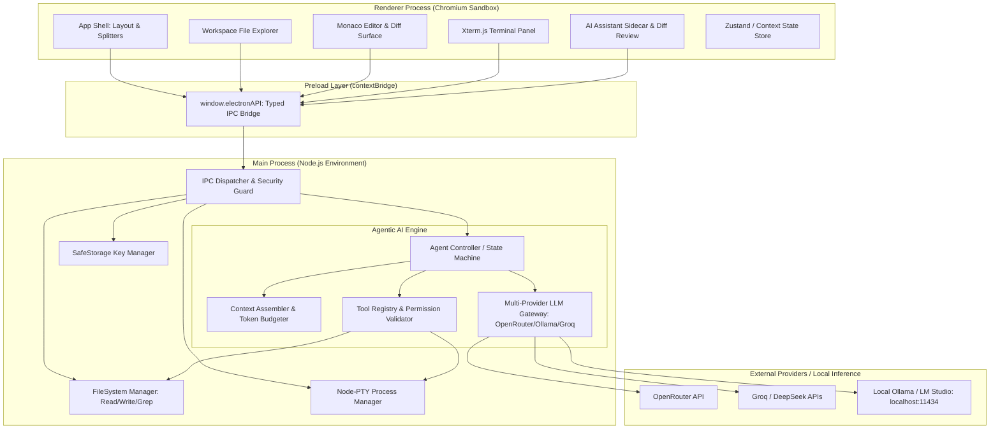
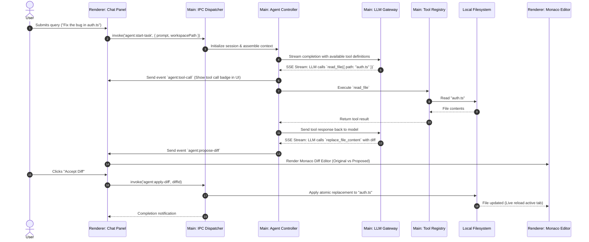

# Architecture Context: Ty-Code Desktop

## Architecture Overview
Ty-Code is architected as a modular, sandboxed Electron desktop application separating the UI rendering surface, native system operations, and the agentic AI reasoning loop. Inspired by the proxy architecture of [`free-claude-code`](https://github.com/Alishahryar1/free-claude-code) and the high-performance desktop workflow of VS Code / Antigravity, the system ensures non-blocking UI responsiveness, strict security sandboxing, and pluggable LLM integrations.

---

## Tech Stack

| Layer | Technology | Role & Justification |
| :--- | :--- | :--- |
| **Desktop Shell** | Electron 33+ (Node 20+ LTS) | Cross-platform OS integration (Windows, macOS, Linux), native window frames, file dialogs, hardware acceleration. |
| **Frontend Framework** | React 18/19 + TypeScript | Componentized UI architecture for the editor tabs, file explorer tree, sidecar chat, and diff panels. |
| **Editor Core** | Monaco Editor (`@monaco-editor/react`) | Industry-standard code editor engine behind VS Code: syntax coloring, code folding, intellisense, diff editor (`monaco.editor.createDiffEditor`). |
| **Terminal Subsystem** | `xterm.js` + `node-pty` | Hardware-accelerated terminal emulation in renderer backed by real PTY instances (PowerShell, Bash, Zsh) in main process. |
| **AI Protocol Gateway** | TypeScript Multi-Provider Client | Architecture inspired by `free-claude-code`: unified client for OpenRouter, DeepSeek, Groq, NVIDIA NIM, Ollama, and Anthropic endpoints with SSE streaming. |
| **Agent Execution Loop** | TypeScript Tool State Machine | Autonomous agent loop managing conversation history, system prompt budgeting, tool call invocations, error reflection, and result routing. |
| **Styling & Design System** | Tailwind CSS / CSS Modules | VS Code dark-mode aesthetics, responsive flex/grid layouts, polished micro-interactions, smooth splitter panes. |
| **Local Persistence** | Electron `safeStorage` + `electron-store` | Hardware-encrypted API keys and credentials; JSON-backed local storage for workspace settings, recent projects, and chat history. |
| **Build & Bundling** | Vite + electron-builder | Ultra-fast HMR in development, optimized code splitting, native code signing and cross-platform binary installer packaging. |

---

## High-Level System Architecture



---

## System Boundaries & Directory Structure

```
ty-code/
├── src/
│   ├── main/                           # Electron Main Process (Node.js)
│   │   ├── index.ts                    # Application lifecycle, window creation
│   │   ├── ipc/                        # IPC channel handlers
│   │   │   ├── fs-handlers.ts          # File I/O, directory scanning, search
│   │   │   ├── pty-handlers.ts         # PTY terminal spawning & I/O streaming
│   │   │   ├── agent-handlers.ts       # AI agent turn orchestration & streams
│   │   │   └── config-handlers.ts      # SafeStorage settings and API keys
│   │   ├── agent/                      # Core Agentic Intelligence Engine
│   │   │   ├── agent-loop.ts           # Autonomous step cycle & termination conditions
│   │   │   ├── context-manager.ts      # Sliding window token budgeting & system prompts
│   │   │   ├── tool-registry.ts        # Built-in tools (read, write, edit, grep, exec)
│   │   │   └── diff-engine.ts          # Multi-chunk diff generation and verification
│   │   ├── providers/                  # Multi-Provider Gateway (free-claude-code inspired)
│   │   │   ├── provider-factory.ts     # Adapter selector (OpenRouter, Groq, Ollama, etc.)
│   │   │   ├── base-provider.ts        # Common streaming and tool call interface
│   │   │   ├── openrouter-provider.ts  # OpenRouter OpenAI-compatible client
│   │   │   ├── ollama-provider.ts      # Local Ollama REST/NDJSON client
│   │   │   ├── groq-provider.ts        # Groq high-speed inference adapter
│   │   │   └── sse-parser.ts           # Robust Server-Sent Events stream parser
│   │   └── security/                   # Path sanitization, command confirmation
│   ├── preload/                        # Isolated Bridge Scripts
│   │   ├── index.ts                    # contextBridge exposure
│   │   └── types.ts                    # Shared IPC contract interfaces
│   └── renderer/                       # React 19 Frontend Surface
│       ├── index.html                  # Entry DOM HTML
│       ├── src/
│       │   ├── App.tsx                 # Root layout & splitter dock
│       │   ├── components/
│       │   │   ├── explorer/           # Project directory tree & file icons
│       │   │   ├── editor/             # Monaco editor, tabs, breadcrumbs
│       │   │   ├── diff/               # Monaco Diff Editor modal / inline view
│       │   │   ├── chat/               # Assistant conversational thread & tool logs
│       │   │   ├── terminal/           # Xterm.js terminal emulator drawer
│       │   │   └── settings/           # Model picker, API key inputs, system config
│       │   ├── hooks/                  # Custom React hooks (useMonaco, useAgent, usePty)
│       │   └── state/                  # Zustand global stores (workspace, editor, chat)
├── context/                            # Continuous project memory & AI specs
├── electron-builder.yml                # Packaging and distribution configuration
├── vite.config.ts                      # Vite build configuration
└── package.json
```

---

## Data Flow & Execution Sequences

### 1. Agent Tool Execution Sequence


---

## Extension Runtime Boundary

- Built-in extensions execute as statically bundled Vite module Workers (`src/renderer/src/workers/extension-worker.ts`); the Worker receives no DOM, Node APIs, `require`, `process`, or full Electron bridge.
- Worker messages use shared Zod schemas, versioned UUID-correlated request/response envelopes, per-session nonces, a 256 KiB payload cap, a 32-call concurrency limit, bounded timeouts, and a watchdog with at most one restart.
- Only built-in manifests may activate. Marketplace listings persist as metadata-only, remain disabled, and do not download package contents. VSIX installation is refused until archive validation and review are implemented. The third-party preference is stored but is not an execution switch in this release.
- Electron capability provider mediates declared `workspace.fs`, editor, window, terminal, agent, and Git read operations. Main checks workspace containment, symlink resolution and sensitive paths. Mutating shell/Git actions are not extension capabilities.
- Future webview UI must be separate from the Worker and use an opaque-origin iframe (`sandbox="allow-scripts"`, no `allow-same-origin`) with nonce-verified `MessageChannel`; webviews are disabled today. See [EXTENSION-API-MATRIX.md](../docs/EXTENSION-API-MATRIX.md).

## Critical Invariants

1. **Strict Context Isolation**: `contextIsolation: true` and `nodeIntegration: false` must always be enforced in Electron's `BrowserWindow` webPreferences. All communication must pass strictly through `contextBridge` with validated payload schemas.
2. **Atomic Disk Operations**: When the AI agent modifies code via `replace_file_content` or `write_file`, writes must be atomic (e.g., write to temporary file then replace, or verify character-exact pre-conditions) to prevent file corruption.
3. **Target Content Exactness**: The agent's `replace_file_content` tool strictly validates that `TargetContent` exists uniquely within the designated line range before writing to prevent ambiguous overwrites.
4. **Non-Blocking Main Thread**: File search, heavy regex matching, and network requests must never block the Electron main thread. Long-running tasks use async streams or worker threads.
5. **Encrypted Secret Storage**: User API keys (OpenRouter, DeepSeek, Groq, etc.) are never saved in plain text; they are encrypted using Electron's OS-backed `safeStorage` API.
6. **Graceful Degradation / Offline Capability**: If no internet access or API key is provided, the application automatically allows fallback to local Ollama (`http://localhost:11434`) or LM Studio endpoints.
