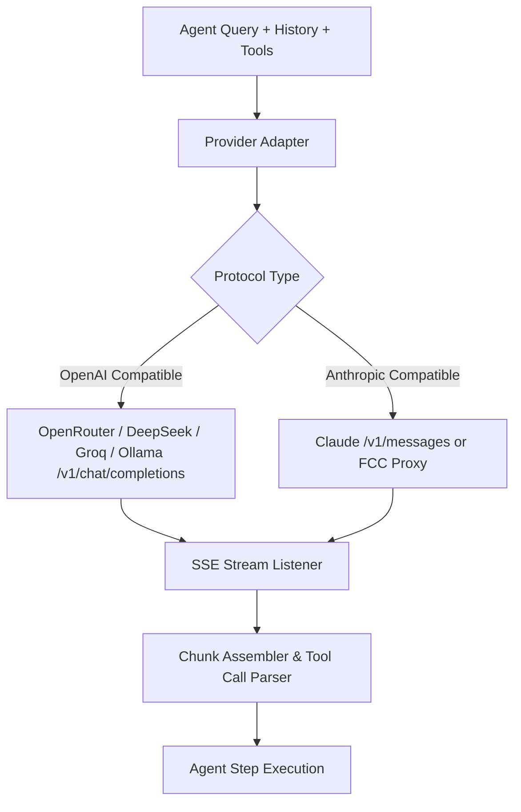

# Domain Specification: Desktop AI Coding Assistant & Monaco Engine

## Ground Truth Definitions

In Ty-Claude, "successful agentic coding assistance" is strictly defined by four invariant criteria:
1. **Preservation of Intent**: The AI modification must solve the user's prompt without introducing side effects or unrequested refactorings.
2. **Syntactic & Structural Integrity**: The generated code must parse without syntax errors, adhere to existing codebase indentation/style, and preserve existing comments.
3. **Atomic Exactness**: Code edits must match exact character sequences in the target file. No partial line corruptions or misplaced code blocks are tolerated.
4. **User Agency & Transparency**: The user retains complete authority over workspace changes—every tool execution, shell command, and file modification is visible in the chat feed and inspectable via visual diff.

---

## Agent Tool Specification (JSON Schemas)

The AI Agent interacts with the local workspace through standard JSON tool declarations:

### 1. `read_file`
Retrieves text from a file in the workspace with optional line slicing to conserve context tokens.
```json
{
  "name": "read_file",
  "description": "Read the contents of a file in the workspace. Supports line range slicing.",
  "parameters": {
    "type": "object",
    "properties": {
      "filePath": { "type": "string", "description": "Relative path to file from workspace root." },
      "startLine": { "type": "integer", "description": "1-based starting line number (optional)." },
      "endLine": { "type": "integer", "description": "1-based ending line number (optional)." }
    },
    "required": ["filePath"]
  }
}
```

### 2. `replace_file_content`
Performs targeted, surgical edits to an existing file by replacing an exact contiguous block of code.
```json
{
  "name": "replace_file_content",
  "description": "Replace an exact target block of text within a file with replacement content.",
  "parameters": {
    "type": "object",
    "properties": {
      "filePath": { "type": "string", "description": "Relative path to the target file." },
      "targetContent": { "type": "string", "description": "Exact text substring to be replaced (must match whitespace exactly)." },
      "replacementContent": { "type": "string", "description": "The new text that will replace targetContent." },
      "startLine": { "type": "integer", "description": "Estimated starting line number for search optimization." },
      "endLine": { "type": "integer", "description": "Estimated ending line number for search optimization." }
    },
    "required": ["filePath", "targetContent", "replacementContent"]
  }
}
```

### 3. `write_file`
Creates a new file or completely overwrites an existing file.
```json
{
  "name": "write_file",
  "description": "Create a new file with content or overwrite an existing file.",
  "parameters": {
    "type": "object",
    "properties": {
      "filePath": { "type": "string", "description": "Relative path to file from workspace root." },
      "content": { "type": "string", "description": "Full text content to write." },
      "overwrite": { "type": "boolean", "description": "True to overwrite if file already exists." }
    },
    "required": ["filePath", "content"]
  }
}
```

### 4. `run_command`
Executes a terminal command within the workspace environment, capturing stdout and stderr.
```json
{
  "name": "run_command",
  "description": "Execute a shell command in the project directory (PowerShell/Bash).",
  "parameters": {
    "type": "object",
    "properties": {
      "command": { "type": "string", "description": "Command string to run in the terminal." },
      "timeoutMs": { "type": "integer", "description": "Maximum execution time in milliseconds (default: 30000)." },
      "cwd": { "type": "string", "description": "Subdirectory relative to workspace root (optional)." }
    },
    "required": ["command"]
  }
}
```

### 5. `list_dir` & `grep_search`
Navigates directories and finds text occurrences across files rapidly without polluting context with unneeded file bodies.

---

## Multi-Provider LLM Gateway Specification

Inspired by the protocol handling in `free-claude-code`, Ty-Claude bridges OpenAI-compatible and Anthropic-compatible message formats into a standardized internal representation:



### Supported Provider Presets
1. **OpenRouter**:
   - Base URL: `https://openrouter.ai/api/v1`
   - Default Coding Models: `deepseek/deepseek-chat`, `deepseek/deepseek-r1`, `qwen/qwen-2.5-coder-32b-instruct`, `meta-llama/llama-3.3-70b-instruct:free`
2. **Groq**:
   - Base URL: `https://api.groq.com/openai/v1`
   - Ultra-fast token generation (~250-500 tokens/sec) with `llama-3.3-70b-versatile` or `qwen-2.5-coder-32b`.
3. **Local Ollama**:
   - Base URL: `http://localhost:11434/v1`
   - 100% offline, private inference with models such as `qwen2.5-coder:14b`, `deepseek-r1:14b`.
4. **Direct Anthropic / FCC Server**:
   - Support for routing through a local `fcc-server` (`http://localhost:8082`) or direct Anthropic endpoints.

---

## Evaluation & Benchmark Metrics

| Metric | Target | Measurement Strategy |
| :--- | :--- | :--- |
| **Time to First Token (TTFT)** | < 800ms (Cloud), < 300ms (Groq) | Measure duration from user Enter key to first delta chunk event received in renderer. |
| **Editor Frame Rate** | Constant 60 FPS (16.6ms) | Chrome Performance Profiler during typing, tab switching, and Monaco minimap scrolling. |
| **Tool Call Accuracy** | > 95% valid JSON schema | Track count of JSON parse failures or schema validation errors returned to model. |
| **Atomic Diff Success Rate** | 100% zero corruption | Validate that pre-condition string matches target exactly before writing to disk. |
