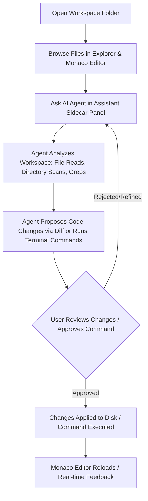

# Project Overview: Ty-Claude Desktop

## Executive Summary
**Ty-Claude** is an open-source, cross-platform desktop AI coding assistant and lightweight IDE built with Electron, Monaco Editor (VS Code's editing core), and an agentic tool-execution engine. Inspired by Claude Code and Antigravity, and leveraging the multi-provider routing architecture pioneered by [`free-claude-code`](https://github.com/Alishahryar1/free-claude-code), Ty-Claude allows developers to pair-program with state-of-the-art AI models—using free, low-cost, or local LLMs (OpenRouter, DeepSeek, Groq, NVIDIA NIM, Ollama, LM Studio) without being locked into expensive proprietary subscriptions.

---

## Core Goals
1. **First-Class Editing Surface**: Provide an authentic VS Code-grade editing experience by embedding the Monaco Editor with syntax highlighting, language services, multi-file tabs, file tree navigation, and side-by-side diff review.
2. **Pluggable & Zero/Low-Cost AI Providers**: Offer dynamic switching between multiple AI backends—including OpenRouter (free and paid models), Groq, DeepSeek, NVIDIA NIM, and local offline inference via Ollama/LM Studio—with full streaming SSE support and OpenAI/Anthropic format translation.
3. **Agentic Coding Capabilities (Claude Code Spirit)**: Implement an autonomous tool-calling loop that can read files, inspect directories, grep for code patterns, execute shell commands in a managed terminal session, and make precise code modifications.
4. **Interactive Diff & Safety Guardrails**: Ensure user agency with inline/side-by-side diff visualization, chunk rejection/acceptance, and execution confirmation prompts for destructive shell actions.
5. **Cross-Platform Native Desktop**: Package as a self-contained, responsive desktop application for Windows, macOS, and Linux with secure IPC boundaries and native filesystem performance.

---

## Core User Flow

1. **Workspace Initialization**: The user opens any project directory. Ty-Claude scans the workspace, loads the file tree, respects `.gitignore`, and generates a project index.
2. **Editor Engagement**: The user browses, edits, and navigates files in multi-tab Monaco editor sessions with syntax highlighting and code completion.
3. **Conversational Prompting**: The user queries the AI assistant in the right sidecar drawer (e.g., *"Refactor our auth middleware to support JWT refresh tokens"* or *"Debug why the test suite is failing"*).
4. **Agentic Investigation**: The AI agent autonomously calls workspace tools (`list_dir`, `read_file`, `grep_search`, `run_command`) to gather ground truth.
5. **Diff Proposal & Verification**: The agent presents unified/side-by-side diffs. The user can review changes, accept/reject individual chunks or entire files, and watch tests run in the integrated terminal drawer.
6. **Execution & Feedback Loop**: Once confirmed, changes are written directly to disk, Monaco models update instantly, and results feed back into the multi-turn conversational context.

---

## Features & Capabilities

### 1. Monaco Editor & Workspace Surface
- **Multi-File Tab Management**: Open, switch, dirty-state tracking, save/save-all, and split editor layouts.
- **Project File Tree**: File explorer with folder nesting, file creation/deletion/renaming, context menus, and file watcher sync.
- **Language Services & Highlighting**: Out-of-the-box Monaco support for TypeScript, JavaScript, Python, Rust, Go, HTML, CSS, JSON, Markdown, and C/C++.
- **Integrated Terminal Drawer**: Xterm.js terminal connected to native shells (PowerShell, Bash, Zsh) via Node-pty.
- **Side-by-Side & Inline Diff Views**: Monaco Diff Editor integration for previewing AI-proposed edits against working files.

### 2. Multi-Provider AI Engine (Inspired by `free-claude-code`)
- **Configurable Provider Gateway**: Pluggable backend adapter supporting:
  - **OpenRouter**: Access to hundreds of open-source and commercial models (including free-tier models like DeepSeek V3/R1, Qwen 2.5 Coder, Llama 3.3).
  - **Direct Cloud APIs**: Groq (high-speed inference), DeepSeek direct, Google Gemini, Mistral, NVIDIA NIM.
  - **Local Offline Models**: Ollama (`ollama run qwen2.5-coder`, `deepseek-r1`), LM Studio, and `llama.cpp` local endpoints.
- **Protocol Translation Layer**: Emulates Anthropic and OpenAI tool-calling semantics, streaming SSE parser, and normalized reasoning tokens.
- **Key & Endpoint Management**: Per-provider API key storage encrypted via Electron's `safeStorage`, custom endpoint URLs, and model parameter tuning (temperature, max tokens, top-p).

### 3. Agentic Coding Core
- **Autonomous Tool Loop**: Maximum step budget, reactive execution, and automatic error self-correction.
- **Tool Suite**:
  - `read_file`: Read target files with slice/line-range pagination.
  - `write_file`: Create new files or overwrite existing files.
  - `replace_file_content`: Precise string/chunk replacement with collision detection.
  - `run_command`: Execute shell commands with real-time output streaming and timeout management.
  - `list_dir`: Hierarchical directory listing with size and child count.
  - `grep_search`: Fast pattern search across workspace files.
- **Context Management**: Token budgeting, smart file snippet caching, system prompt customization, and workspace awareness.

### 4. Safety & Developer Experience
- **Permission Interceptors**: Dangerous command warnings (e.g., `rm -rf`, `git reset --hard`, destructive scripts).
- **Undo / Revert System**: Instant rollback of AI edits from disk history or git staging.
- **Workspace Settings**: Per-project `.tyclaude/config.json` for custom instructions, model preferences, and environment variables.

---

## Scope Boundaries

### In Scope (MVP & Production Architecture)
- Standalone Electron application bundle for Windows (`.exe` / portable), macOS (`.dmg`), and Linux (`.AppImage` / `.deb`).
- Fully functional Monaco Editor with tabs, dirty state, and project file tree.
- Built-in multi-provider API client with streaming response and tool-calling loop.
- Agent toolset: file operations (`read`, `write`, `replace`), directory search, pattern grep, and shell execution.
- Sidecar AI chat interface with markdown rendering, code block copy/apply, and diff review.
- Local encrypted API key storage.
- Integrated Xterm.js terminal.

### Out of Scope (Initial Phase)
- Cloud account sync / hosted SaaS database (everything runs 100% locally on the user's desktop).
- Proprietary proprietary extension marketplace (leverages Monaco native features rather than full VS Code `.vsix` ecosystem initially).
- Multi-user real-time collaborative editing (single-developer desktop paradigm).

---

## Success Criteria & Key Performance Indicators
1. **Editor Latency**: Monaco editor input latency < 16ms (60 FPS rendering); file tree loads 10,000+ files in < 500ms.
2. **Provider Flexibility**: Seamless switching between OpenRouter, DeepSeek, Groq, and local Ollama without restarting the app.
3. **Agent Reliability**: Successful multi-step autonomous tool execution (find file -> inspect code -> patch error -> run build) with 0 IPC deadlocks.
4. **Diff Fidelity**: Accurate visual diffs generated and safely applied with exact character/indentation preservation.
5. **Standalone Distribution**: Portable cross-platform binary executable requiring zero global Python/Node prerequisites for basic usage.
