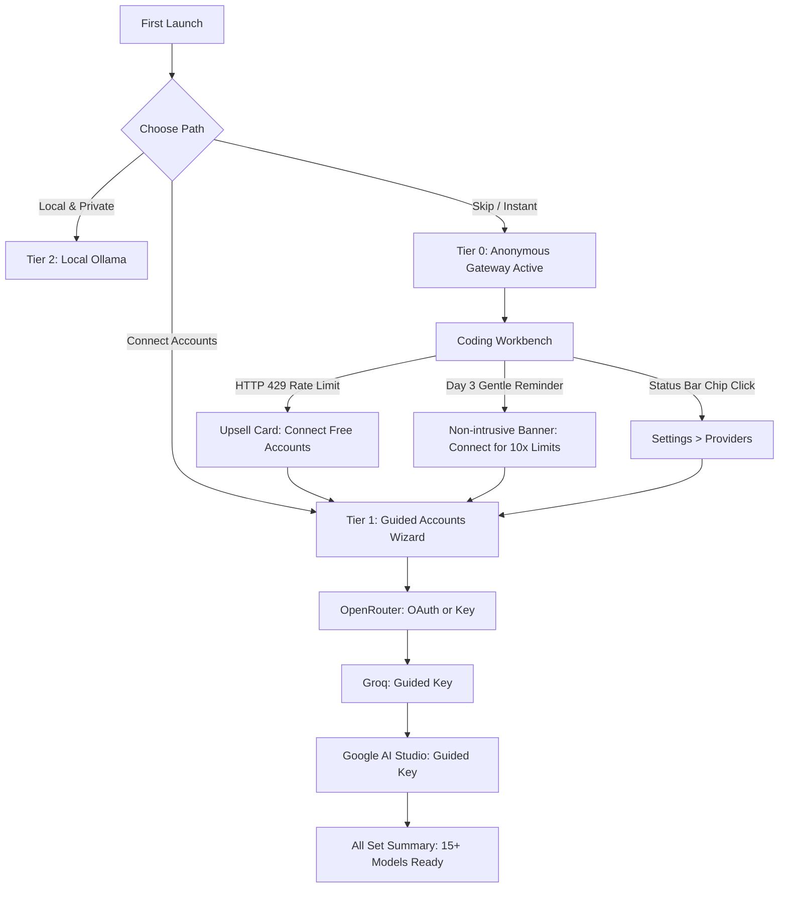

# Unified Provider Access & Auto-Provisioning Trade-offs

> **Phase**: UnifiedProvisioning  
> **Brand**: Ty-Code  
> **Version**: 1.0.0  
> **Scope**: Provider Access Tiers, Architectural Automation Invariants, and Tier 4 Sponsored Pool Economics  
> **Evidence Artifact**: docs/traces/onboarding-provisioning.json

---

## 1. Executive Summary & Provisioning Hierarchy

Ty-Code implements a single, unified provisioning system across 5 distinct tiers. Every tier shares one local credential store (`safeStorage`), one status surface (the Status Bar provider chip), and one upgrade path (accessible via the Onboarding Wizard and Settings).

| Tier | Name | Role & Target Audience | Providers | Configuration Required | Rate Limits | Key Storage |
| :--- | :--- | :--- | :--- | :--- | :--- | :--- |
| **Tier 0** | **Anonymous Gateway** | Zero-config default & skip fallback | OpenKilo anonymous gateway (`deepseek-r1-0528:free`, `qwen3-coder:free`, `llama-3.3-70b:free`), Hugging Face inference | Zero user action (activated automatically on first launch or skip) | Shared pool (~50 req/hr per instance) | Ephemeral session tokens / No user key |
| **Tier 1** | **Guided Accounts** | Primary onboarding path for free access | OpenRouter (10+ free models), Groq (Llama/Mixtral), Google AI Studio (Gemini 2.0 Flash) | User registers own free accounts; step-by-step guided wizard | Generous personal free quotas (e.g. Groq 14,400 req/day, Gemini 15 RPM) | Encrypted locally via OS `safeStorage` (DPAPI/Keychain) |
| **Tier 1b**| **One-Click OAuth** | Lowest-friction variant for supported providers | OpenRouter PKCE (`ty-code://` loopback redirect), Kilo OAuth | One-click browser authorization; no key copy/pasting | Provider personal free tier | Token lands strictly in local `safeStorage` |
| **Tier 2** | **Local & Private** | 100% offline & enterprise air-gapped | Ollama auto-detect at `localhost:11434` (`qwen2.5-coder`, `llama3.2`) | Local install; auto-detected on boot | Unlimited local hardware capacity | No keys; zero network calls; zero telemetry |
| **Tier 3** | **BYOK (Bring Your Own Key)**| Power users, paid API keys, custom endpoints | Anthropic Claude, OpenAI, DeepSeek, custom OpenAI-compatible endpoints (LM Studio, vLLM) | User provides custom API key or base URL | Determined by user's paid provider plan | Encrypted locally via OS `safeStorage` |
| **Tier 4** | **Sponsored Pool (Future)** | *Document-only for v1.0.0 — Do NOT Build* | Ty-Code-hosted proxy key pool behind user accounts | User account login | Subsidized pool quota | Centralized server proxy |

---

## 2. What "Fully Automatic" Can and Cannot Mean

A frequent question in developer tools is: *"Why can't Ty-Code automatically generate API keys without the user having to do anything?"*

It is critical to distinguish between legitimate client-side automation and prohibited or unsustainable automation:

### What Cannot Be Built (Prohibited Automation)
1. **Automated Headless Account Creation**:
   - Provider terms of service (OpenAI, Anthropic, Google, Groq, OpenRouter) strictly prohibit automated, programmatic creation of developer accounts.
   - Signup flows require email verification, SMS verification, or OAuth with Google/GitHub, as well as Cloudflare Turnstile or CAPTCHA challenges to prevent sybil attacks.
   - Any client app attempting to automate account creation on behalf of users would be immediately blacklisted, violating computer fraud and anti-abuse policies.
2. **Hardcoded or Baked Secrets in Binaries**:
   - Shipping hardcoded developer API keys inside distributed client binaries (macOS, Windows, Linux) is fundamentally insecure.
   - Reverse-engineering extractors would discover the embedded keys within minutes, leading to rapid exhaustion, denial of service for all users, and massive financial liability.
   - Ty-Code enforces this invariant via CI guard `scripts/no-baked-secrets.mjs`.

### What Ty-Code Delivers Instead (Maximum Permissible Automation)
1. **Instant Zero-Config Fallback (Tier 0)**:
   - On the very first launch, Ty-Code immediately activates Tier 0 Anonymous Access. Users who click "Skip" can immediately run coding tasks without configuring anything.
2. **One-Click OAuth with Loopback Capture (Tier 1b)**:
   - For providers supporting PKCE OAuth (such as OpenRouter), authentication requires just a single click. The system browser opens, user confirms access, and the token loops back to `127.0.0.1` and lands directly in OS `safeStorage`. Zero key pasting is required.
3. **Streamlined Guided Onboarding (Tier 1)**:
   - Deep-links take users directly to API key generation dashboards.
   - Clipboard auto-detection instantly validates key format upon paste (`sk-or-`, `gsk_`, `AIza`) and runs a live 1-token Test Connection before saving.
4. **Auto-Detection Vault**:
   - Automatically scans local environment variables (`OPENAI_API_KEY`, `ANTHROPIC_API_KEY`, `GROQ_API_KEY`, etc.), Git credentials, and tool configuration files, enabling one-click import into `safeStorage`.

---

## 3. Tier 4: Sponsored Key Pool — Economics & Trigger Conditions

> [!IMPORTANT]
> Tier 4 is **DOCUMENT-ONLY for v1.0.0**. No server proxies, centralized key pools, or shared billing paths are implemented in this release. This section documents the operational mathematics and criteria for future implementation.

### 3.1 The Economic Reality of Hosted Free Pools
Operating a centralized key pool where Ty-Code subsidizes model token usage requires continuous capital expenditure:

#### Token Consumption Model (Per 1,000 Active Free Users)
- **Active User Definition**: 1 session per business day (~22 active days/month).
- **Average Usage per Session**:
  - 15 chat/generation turns per day.
  - Average prompt size (including code context): 1,200 input tokens.
  - Average completion size: 350 output tokens.
  - Daily tokens per user: ~18,000 input tokens + ~5,250 output tokens.
  - Monthly tokens per 1,000 active users:
    - Input: $1,000 \times 22 \times 18,000 = 396,000,000\text{ tokens}$ (~396M tokens).
    - Output: $1,000 \times 22 \times 5,250 = 115,500,000\text{ tokens}$ (~115M tokens).

#### Cost Calculations across Model Blends
| Model Tier | Blend % | Blended Input Cost / 1M | Blended Output Cost / 1M | Monthly Input Cost | Monthly Output Cost | Total Monthly Cost |
| :--- | :--- | :--- | :--- | :--- | :--- | :--- |
| **Efficient Coding** (DeepSeek V3 / Qwen 2.5 Coder) | 70% | $0.14 | $0.28 | $38.80 | $22.64 | $61.44 |
| **High-Speed LPU** (Groq Llama 3.3 70B) | 20% | $0.59 | $0.79 | $46.73 | $18.25 | $64.98 |
| **Reasoning Tier** (DeepSeek R1 / Claude 3.5 Haiku) | 10% | $0.80 | $2.40 | $31.68 | $27.72 | $59.40 |
| **Total Model Consumption Cost** | **100%** | — | — | **$117.21** | **$68.61** | **$185.82** |

#### Operational Infrastructure Overhead (Per 1,000 Active Users)
- **Cloudflare Workers / Reverse Proxy**: $15/mo (request routing, SSL termination).
- **Abuse & Sybil Protection (Cloudflare Turnstile + Redis Rate Limiter)**: $40/mo.
- **Ledger & Auth Database (Postgres / Supabase Pool)**: $25/mo.
- **Payment Processing / Stripe Fixed Charges (Chargebacks / Risk)**: $30/mo.
- **Safety Margin (Buffer for high-token repo indexing & spikes)**: 150% - 250%.
- **Realistic Fully Burdened Cost**: **$600 to $1,500 / month per 1,000 active free users**.

### 3.2 Trigger Conditions for Tier 4 Implementation
Ty-Code will **NOT** build or ship Tier 4 until all the following trigger conditions are verified:
1. **Sustained Funding Milestone**:
   - A minimum of 6 months of operational runway specifically reserved for LLM infrastructure ($10,000+ dedicated pool budget).
2. **Paid Subscription Tier (Ty-Code Pro)**:
   - A functional Stripe-backed Pro tier ($15-20/month) where paying subscribers cross-subsidize free tier usage at a healthy 1:10 ratio.
3. **Automated Abuse Shield**:
   - Hardware-bound fingerprinting or GitHub OAuth authentication to prevent single users from draining the pool with infinite loop scripts.

---

## 4. User Journey & Upgrade Matrix

---

## 5. Security & Privacy Invariants

1. **Zero-Server Key Storage**:
   - Provider API keys entered by users are stored exclusively in the local operating system's credential vault (`safeStorage` utilizing Windows DPAPI, macOS Keychain, or Linux Secret Service).
   - Keys are never uploaded to any Ty-Code server or analytics telemetry.
2. **Transient Reveal**:
   - The "Reveal Key" toggle in Settings reads credentials into memory only on user request and does not write unencrypted keys to logs or temporary files.
3. **Local Ledger Attribution**:
   - Token counters and usage statistics remain strictly on the user's machine in `ty-code-usage.json`. No personal prompt transcripts are centralized.
