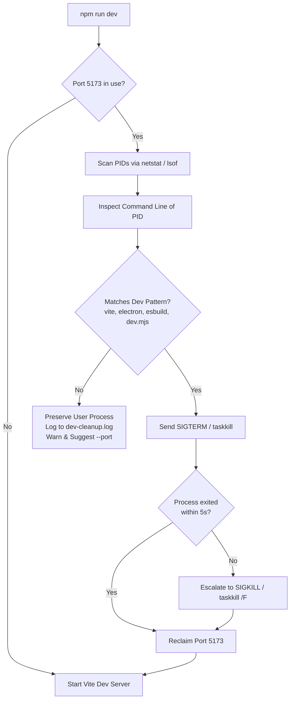

# Ty-Code Developer Setup & Port Management Guide

This document details the local development setup, architectural workflow, and automated dev server port collision handling in **Ty-Code**.

---

## 1. Quick Start

Run the local development environment:

```bash
# Standard dev launch with automatic port cleanup
npm run dev

# Force cleanup mode (auto-kills orphaned dev processes immediately)
npm run dev:force

# Electron development alias
npm run dev:electron
```

---

## 2. Dev Architecture Overview

When running in development mode (`scripts/dev.mjs`), Ty-Code orchestrates three concurrent pipelines:
1. **Vite Dev Server**: Serves the React frontend (Monaco editor, sidecars, modals) at `http://localhost:5173` with HMR (Hot Module Replacement) and CSP injection.
2. **Esbuild Compiler**: Compiles TypeScript main-process (`src/main/index.ts`) and preload scripts (`src/preload/index.ts`) to CommonJS with inline source maps.
3. **Electron Runtime**: Spawns an isolated desktop instance passing `VITE_DEV_SERVER_URL=http://localhost:5173`.

---

## 3. Port Collision Auto-Cleanup (`scripts/port-cleanup.mjs`)

Because Vite uses `strictPort: true` to adhere strictly to the Content Security Policy (CSP), an ungraceful termination (e.g. shell closure or kill signal) can leave an orphaned Node or Electron process bound to port 5173.

To prevent manual `taskkill` or `kill -9` troubleshooting, `scripts/dev.mjs` automatically executes pre-flight port hygiene before binding:



### Safety & Process Discrimination
- **Orphaned Dev Detection**: Matches commands containing `vite`, `electron`, `esbuild`, `dev.mjs`, or `ty-code`. These are safely recycled.
- **User Process Protection**: Non-dev processes (e.g., Python web servers, PostgreSQL, Java microservices) occupying port 5173 are **never killed**. Instead, a warning is printed and the process is preserved:
  ```
  ⚠️  [Dev Cleanup] Port 5173 in use by process 28148 (python app.py). Use --port to choose different port.
  ```

### Audit Log (`scripts/dev-cleanup.log`)
Every cleanup action is appended with an ISO-8601 timestamp to `scripts/dev-cleanup.log`:
```
[2026-10-16T19:30:00.000Z] [PORT_OCCUPIED] Port 5173 is occupied. Scanning listening processes...
[2026-10-16T19:30:00.120Z] [AUTO_CLEANUP] Terminating orphaned dev process PID 59788 (node .../vite) on port 5173.
[2026-10-16T19:30:00.450Z] [TERMINATED] PID 59788 terminated.
[2026-10-16T19:30:00.600Z] [RECLAIMED] Port 5173 successfully reclaimed and ready.
```

---

## 4. Command Line Flags

| Flag | Description | Example |
| :--- | :--- | :--- |
| `--force`, `-f` | Auto-kills orphaned dev processes without interactive prompting | `npm run dev -- --force` or `npm run dev:force` |
| `--port <n>`, `-p <n>` | Specifies a custom TCP port if 5173 is reserved for another app | `npm run dev -- --port 5180` |

---

## 5. Testing & Validation

The port cleanup system is validated via tests ensuring:
1. Stale background processes on port 5173 are cleanly identified.
2. Graceful SIGTERM with 5s timeout escalation to SIGKILL executes without blocking the terminal.
3. User processes are preserved.
4. Subsequent dev runs boot without `EADDRINUSE` errors.
