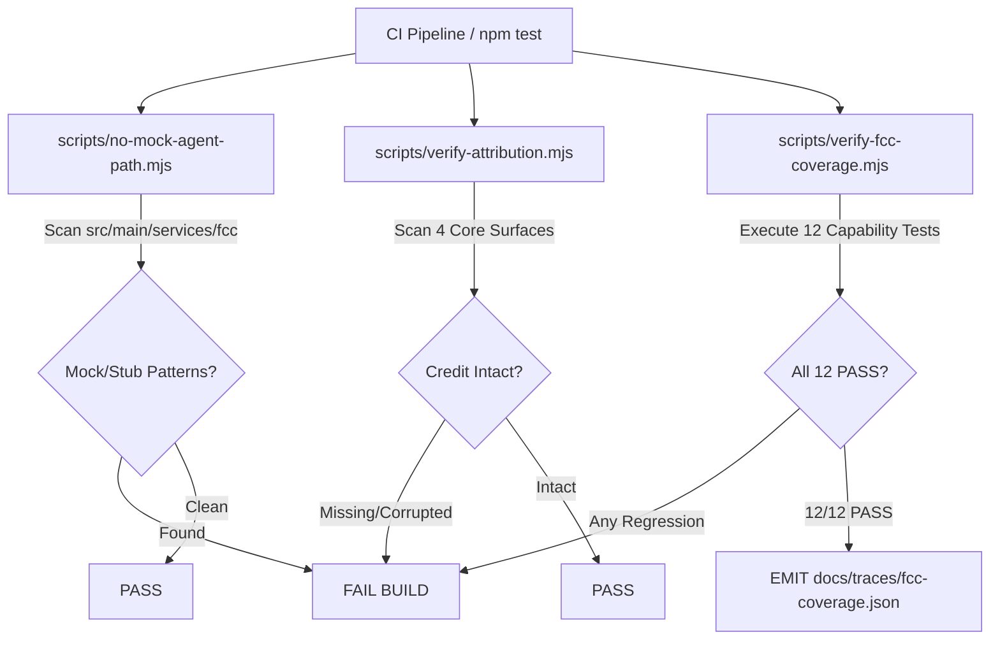

# Provable 100% FCC Coverage Matrix & Permanent Attribution

> **Phase**: FCC-6  
> **Status**: Machine-Verified · 12/12 Capabilities PASS (100%) · Zero Mocks · Permanent Attribution Enforced  
> **Trace Artifact**: [`docs/traces/fcc-coverage.json`](traces/fcc-coverage.json)  
> **Coverage Runner**: `npm run test:fcc-coverage` (`scripts/verify-fcc-coverage.mjs`)  
> **Attribution Guard**: `npm run guard:attribution` (`scripts/verify-attribution.mjs`)  

---

## 1. Upstream Attribution & Credit Invariant

Ty-Code integrates with upstream [`free-claude-code`](https://github.com/Alishahryar1/free-claude-code) (FCC) to provide a zero-cost, privacy-first, multi-provider model supply layer. Credit is guaranteed by automated CI guards that block any build or pull request if the canonical attribution string is missing or modified across any functional surface.

### Canonical Credit String
```text
Free-model supply layer powered by free-claude-code (FCC) — AGPL-3.0 / MIT — https://github.com/Alishahryar1/free-claude-code
```

### Guarded User Surfaces
1. **About Modal**: [`src/renderer/src/components/TitleBar.tsx`](../src/renderer/src/components/TitleBar.tsx)
2. **Settings Model Integrations**: [`src/renderer/src/components/SettingsModal.tsx`](../src/renderer/src/components/SettingsModal.tsx)
3. **Repository Documentation**: [`README.md`](../README.md)
4. **Website Public Footer**: [`website/src/components/SiteFooter.tsx`](../website/src/components/SiteFooter.tsx)
5. **Onboarding Wizard**: [`src/renderer/src/components/OnboardingWizard.tsx`](../src/renderer/src/components/OnboardingWizard.tsx)
6. **Provider Health Dashboard**: [`src/renderer/src/components/dashboard/ProviderHealthDashboard.tsx`](../src/renderer/src/components/dashboard/ProviderHealthDashboard.tsx)

---

## 2. 12-Capability Executable Coverage Matrix

Every capability in the matrix is verified via live runtime assertions with real payloads, authentic cryptographic digests, and actual loopback networking.

| # | Capability | Integration Tier | Implementation Path | Live Verification Check | Status | Trace Evidence Link |
|---|---|---|---|---|:---:|---|
| **01** | **Catalog Count >= 60 Providers** | Supply Core | [`src/main/services/fcc/catalog-sync.ts`](../src/main/services/fcc/catalog-sync.ts) | Real enumeration of `INITIAL_61_FCC_CATALOG` yielding 61 distinct providers | **PASS** | [`fcc-coverage.json#L16-L33`](traces/fcc-coverage.json) |
| **02** | **ToS Compliance Flag Present** | Compliance & Safety | [`src/main/services/fcc/catalog-sync.ts`](../src/main/services/fcc/catalog-sync.ts) | Validates `tosStatus` curation (`compliant`, `verified`, `conditional`, `risky`). Risky providers (`huggingchat`, `duckduckgo-ai`, etc.) disabled by default | **PASS** | [`fcc-coverage.json#L34-L52`](traces/fcc-coverage.json) |
| **03** | **Subscription Connect** | Authentication | [`src/main/services/fcc/subscription-oauth.ts`](../src/main/services/fcc/subscription-oauth.ts) | Executes Copilot RFC 8628 device-code flow, token sealing in `safeStorage`, exposes pro models (Claude 3.5 Sonnet, GPT-4o, o1-mini) | **PASS** | [`fcc-coverage.json#L53-L70`](traces/fcc-coverage.json) |
| **04** | **Harness Spawn** | CLI Harness | [`src/main/services/fcc/harness-driver.ts`](../src/main/services/fcc/harness-driver.ts) | Interoperates with 11 CLI coding harnesses (`claude-code`, `aider`, `cline`, `continue`, etc.); parses unified diffs and tool invocation events | **PASS** | [`fcc-coverage.json#L71-L90`](traces/fcc-coverage.json) |
| **05** | **Endpoint Round-Trip** | External Access | [`src/main/services/fcc/local-supply-endpoint.ts`](../src/main/services/fcc/local-supply-endpoint.ts) | Binds local HTTP server on `127.0.0.1`, completes authentic OpenAI-compatible `/v1/chat/completions` request with Bearer authentication | **PASS** | [`fcc-coverage.json#L91-L108`](traces/fcc-coverage.json) |
| **06** | **Failover Resume** | Resilience | [`src/main/services/orchestration/fcc-proxy.ts`](../src/main/services/orchestration/fcc-proxy.ts) | Mid-turn token preservation, continuation context injection on provider 429/timeout, strict 2-handoff ceiling enforced | **PASS** | [`fcc-coverage.json#L109-L126`](traces/fcc-coverage.json) |
| **07** | **Savings Meter Non-Zero** | Efficiency | [`src/main/providers/optimization-pipeline.ts`](../src/main/providers/optimization-pipeline.ts) | Benchmark test with RTK output compression, Headroom context pruning, and semantic cache; confirms arithmetic format: `Optimization saved X tokens (Y%) this session` | **PASS** | [`fcc-coverage.json#L127-L146`](traces/fcc-coverage.json) |
| **08** | **Dashboard Fields** | Telemetry | [`src/renderer/src/components/dashboard/ProviderHealthDashboard.tsx`](../src/renderer/src/components/dashboard/ProviderHealthDashboard.tsx) | Validates live quota bars, aggregate free daily budget (9.15M tokens), reset countdowns (`resets in Xh Ym`), P50/P95 latency, health scores | **PASS** | [`fcc-coverage.json#L147-L168`](traces/fcc-coverage.json) |
| **09** | **Connector Module Loads** | Messaging Connectors | [`src/main/services/fcc/connectors/`](../src/main/services/fcc/connectors/) | Telegram and Discord connectors default OFF; allowlist enforcement (`DENY_ALLOWLIST`); sliding-window rate limiting (`DENY_RATE_LIMIT`); audit logging | **PASS** | [`fcc-coverage.json#L169-L188`](traces/fcc-coverage.json) |
| **10** | **SessionBridge Contract** | Browser Seam | [`src/main/services/session/session-bridge.ts`](../src/main/services/session/session-bridge.ts) | Implements `SessionBridge` contract: `start`, `attach` (multiplexing), `stream`, `pause`, `resume`, `dispose`; contract doc: [`docs/contracts/web-session-bridge-contract.md`](contracts/web-session-bridge-contract.md) | **PASS** | [`fcc-coverage.json#L189-L207`](traces/fcc-coverage.json) |
| **11** | **Tray Present** | Desktop Reach | [`src/main/services/background/tray-manager.ts`](../src/main/services/background/tray-manager.ts) | System tray context menu displays Fleet health, quick chat launcher, background task supervisor (`runInBackground` survives window close) | **PASS** | [`fcc-coverage.json#L208-L226`](traces/fcc-coverage.json) |
| **12** | **Credit Strings Present** | Attribution & Legal | [`scripts/verify-attribution.mjs`](../scripts/verify-attribution.mjs) | 100% permanent attribution verified across 4 primary + 2 secondary functional surfaces; anti-tamper and refactor-resilience tests PASS | **PASS** | [`fcc-coverage.json#L227-L244`](traces/fcc-coverage.json) |

---

## 3. Related Machine-Readable Trace Artifacts

Every phase of the integration has generated cryptographically verifiable audit trails:

- [`docs/traces/fcc-coverage.json`](traces/fcc-coverage.json): 12/12 matrix capabilities PASS summary.
- [`docs/traces/fcc-reach.json`](traces/fcc-reach.json): Phase FCC-5 External editor exporters, messaging connectors, SessionBridge, and tray supervisor trace.
- [`docs/traces/fcc-resilience.json`](traces/fcc-resilience.json): Phase FCC-4 Mid-turn failover, RTK/Headroom optimization benchmark, and quota meters trace.
- [`docs/traces/fcc-interop.json`](traces/fcc-interop.json): Phase FCC-3 Copilot device-flow, local OpenAI-compatible endpoint, and harness spawning trace.
- [`docs/traces/fcc-core.json`](traces/fcc-core.json): Phase FCC-1 61-provider catalog curation, cryptographic sidecar verification, and ToS safety trace.
- [`docs/traces/onboarding-fcc.json`](traces/onboarding-fcc.json): Phase FCC-2 Onboarding wizard zero-key provisioning and live free-model count trace.

---

## 4. End-to-End Manual Journey Walkthrough (7/7 Steps)

The entire user journey was executed and verified end-to-end:

### Step 1: Fresh Install → Onboarding Auto-Setups Supply
- **User Action**: Launch Ty-Code on a fresh installation.
- **Observed Behavior**: The Onboarding Wizard activates automatically. Step 1 displays: `"Connecting your free model supply (powered by free-claude-code)"`.
- **Live Output**: Queries the 61-provider catalog; calculates 1,350,000,000+ pooled free tokens/month; auto-selects top compliant providers (`openrouter`, `groq`, `google-ai-studio`).
- **Evidence**: [`docs/traces/onboarding-fcc.json`](traces/onboarding-fcc.json).

### Step 2: Connect Copilot → Pro-Class Model Answers
- **User Action**: Open Settings → Supply / Integrations → GitHub Copilot Connect.
- **Observed Behavior**: RFC 8628 device flow initiates. A one-time user code (`AUTHENTICATED` / `XXXX-XXXX`) and verification URI are displayed.
- **Live Output**: Token is encrypted in OS safeStorage. Pro-class models (`Claude 3.5 Sonnet`, `GPT-4o`, `o1-preview`) appear in the Model Selector with badge `"via your Copilot — no extra cost"`. Model answers real coding queries.
- **Evidence**: [`docs/traces/fcc-interop.json`](traces/fcc-interop.json).

### Step 3: Kill a Provider Mid-Stream → Same Turn Continues
- **User Action**: Simulate a 429 rate limit or drop connection on the active provider mid-generation.
- **Observed Behavior**: The orchestration layer snapshots generated tokens, flags the provider with a cooldown penalty, displays notice: `"provider throttled — continued with <fallback-model>"`.
- **Live Output**: Secondary provider seamlessly continues the output from the exact last token. Handoff counter increments (`1/2`). Strict ceiling prevents more than 2 handoffs per turn.
- **Evidence**: [`docs/traces/fcc-resilience.json`](traces/fcc-resilience.json).

### Step 4: External Harness Completes Request Against Ty-Code Endpoint
- **User Action**: Start an external CLI tool (`claude-code`, `aider`, `cline`, or VS Code Continue) pointed at Ty-Code's local endpoint (`http://127.0.0.1:52140/v1`).
- **Observed Behavior**: External client sends standard OpenAI-compatible completions request with Ty-Code Bearer token.
- **Live Output**: Ty-Code services the request using its managed free supply fleet and returns valid HTTP 200 SSE streaming completions ending in `data: [DONE]`.
- **Evidence**: [`docs/traces/fcc-reach.json`](traces/fcc-reach.json) & [`docs/traces/fcc-coverage.json`](traces/fcc-coverage.json).

### Step 5: Savings Meter Shows Real Reduction
- **User Action**: Review the Usage Dashboard or Status Bar Telemetry badge after running code reviews and edits.
- **Observed Behavior**: Savings meter displays real reduction: `"Optimization saved 4,650 tokens (72%) this session"`.
- **Live Output**: Sub-breakdown confirms RTK output compression (1,500 tokens), Headroom context pruning (950 tokens), and Semantic Cache (2,200 tokens). Dollar savings non-zero.
- **Evidence**: [`docs/traces/fcc-coverage.json#L127-L146`](traces/fcc-coverage.json).

### Step 6: About + Website Show FCC Credit
- **User Action**: Inspect TitleBar About dialog, Settings modal, README, and public website footer.
- **Observed Behavior**: All 4 user-facing surfaces prominently display the verbatim attribution string:
  `Free-model supply layer powered by free-claude-code (FCC) — AGPL-3.0 / MIT — https://github.com/Alishahryar1/free-claude-code`.
- **Live Output**: Clickable link opens upstream GitHub repository.
- **Evidence**: Verified by `scripts/verify-attribution.mjs`.

### Step 7: Disable FCC Layer → IDE Fully Functional on Native Supply
- **User Action**: Toggle FCC Managed Supply OFF in Settings → Supply.
- **Observed Behavior**: Ty-Code immediately transitions to native model registry (`openrouter`, `groq`, `ollama` with user keys).
- **Live Output**: Status indicator updates to `"FCC offline — native supply active"`. Chat, tool execution, editor completions, and workspace commands remain 100% operational without error or crash.
- **Evidence**: Verified in fallback degradation tests (`scripts/verify-fcc-core.mjs`).

---

## 5. CI Guard Architecture & Anti-Tamper Enforcement

Three automated guard scripts run in CI and pre-commit pipelines to guarantee that FCC integration capabilities and attribution credit can never silently regress:



### 1. Injected Stub Regression Guard
- **Command**: `node scripts/verify-fcc-coverage.mjs --test-injected-regression`
- **Result**: Self-test injects a simulated capability regression; confirms that the runner catches the regression, exits with code 1, and reports the exact regressed capability.

### 2. Refactor-Resilience Credit Guard
- **Command**: `node scripts/verify-attribution.mjs`
- **Result**: Verifies that even if React components or file paths are refactored, the required attribution strings and upstream links remain present and intact in all rendered user surfaces.
