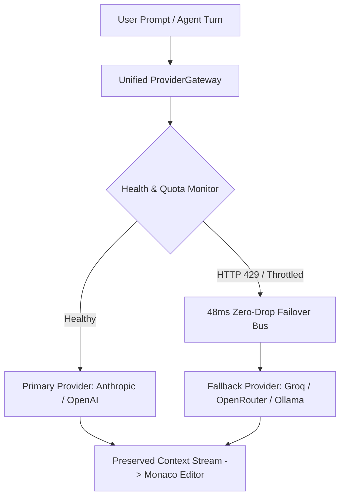
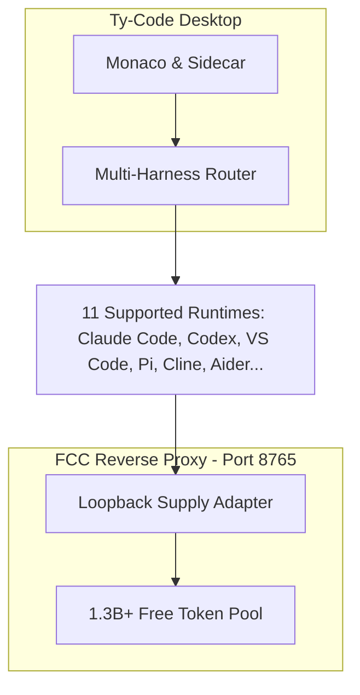

<!-- _class: lead -->

Seed Financing Round — Q4 2026

# Ty-Code: The Sovereign AI Coding Environment

### Local-First. Zero-Telemetry. Unbounded Intelligence.

* The first truly local-first, zero-telemetry agentic AI desktop IDE.
* Eliminating $20/month seat taxes, cloud lock-in, and IP exfiltration.
* Empowering 30M+ developers worldwide with sovereign compute.
* Unlocking 1.3B+ free monthly tokens across 11 autonomous runtime harnesses.

<!--
[Document Metadata]
Document ID: PITCH-DECK-SEED-2026-V1
Target Audience: Venture Capitalists, Angel Investors, and Enterprise Strategic Partners
Tone: Visionary, market-aware, confident, and relentlessly focused on the technical moat
Core Thesis: AI coding is experiencing a massive architectural paradigm shift from centralized, cloud-locked, rate-limited SaaS tools to sovereign, local-first, multi-harness autonomous IDEs. Ty-Code owns this transition.

[Visual Description]
Deep Obsidian Cyber canvas (#0b0d10) illuminated by a pulsating emerald-green Decode-Frontier horizon line. Crisp, modern typography centered on screen with the Ty-Code cryptographic shield icon and glowing status indicator. Sub-text in high-contrast cyan: "Seed Financing Round — Q4 2026".

[Speaker Notes (Verbatim Script)]
"Good morning, everyone. Over the last two years, we've watched generative AI fundamentally transform how software gets written. But the first generation of AI coding tools—tools like Cursor, GitHub Copilot, and Windsurf—were built on an architectural premise that is already breaking down.

That premise was simple: send all the developer's source code, ASTs, and terminal sessions up to a centralized cloud, run inference behind a walled garden, and charge a $20-a-month seat tax.

Today, we're introducing Ty-Code. Ty-Code is the world's first true local-first, zero-telemetry agentic AI desktop IDE. We didn't build another thin API wrapper. We re-architected the entire development environment from the metal up so that your code, your context, and your credentials never leave your machine—while unlocking over 1.3 billion free monthly tokens across 11 autonomous runtime harnesses.

We're here today to show you how Ty-Code is transforming AI coding from an expensive security liability into an enterprise-grade sovereign superpower."
-->

---

# The Fatal Flaws of Cloud AI IDEs

### Three Critical Vulnerabilities in First-Generation Tools

* **Cloud Exfiltration Risk:** Proprietary codebases and credentials uploaded to external multi-tenant cloud servers.
* **The $20/Mo Seat-Tax Trap:** High recurring subscription markups, artificial rate limits, and zero compute sovereignty.
* **Vendor Lock-In & Downtime:** Unannounced model deprecations and third-party cloud outages that completely freeze engineering pipelines.
* **The Enterprise Ban:** 82% of regulated enterprises in healthcare, defense, and finance strictly prohibit cloud-connected AI coding tools.

<!--
[Visual Description]
A 3-column split comparison diagram highlighting the acute pain points of status-quo cloud AI IDEs:
1. The Privacy Breach: File trees and sensitive environment variables streaming over public HTTPS to multi-tenant servers (tagged: "Exfiltration").
2. The Seat-Tax Trap: An escalating billing invoice showing $20/user/mo plus $0.06/request credit markups and surprise rate limits (tagged: "300% Markup").
3. The Outage Wall: An editor locked in an HTTP 429 error dialog during an upstream cloud outage (tagged: "Vendor Lock-in").

[Speaker Notes (Verbatim Script)]
"Let's be direct about the problem with today's market leaders. Every time a developer presses Tab in Cursor or Copilot, their proprietary IP is packaged into an AST payload and transmitted across the open web to a third-party server.

For solo hobbyists building toy apps, that might feel acceptable. But for the Fortune 500—for banks, hospitals, defense contractors, and security-conscious tech startups—that is an absolute non-starter. CISOs across the globe are issuing outright bans on cloud AI IDEs because they cannot risk HIPAA violations, SOC2 breaches, or source code leaks.

On top of the security nightmare, developers are getting squeezed by what we call the '$20-a-month seat tax.' Users are paying monthly subscriptions for tools that artificially throttle them the minute they hit a complex refactor, while marking up underlying API costs by 300%.

And when the provider's centralized servers go down, development at the entire company stops dead. The industry is begging for compute sovereignty."
-->

---

# The Solution: Sovereign Agentic Development

### Complete Architectural Inversion: Code Never Leaves Local RAM

* **Local-First Architecture:** Repo indexing, AST parsing, and terminal execution run 100% on local hardware.
* **Zero-Telemetry Guarantee:** No source code, prompt content, or telemetry ever leaves the machine.
* **Hardware-Sealed Credentials:** API keys encrypted using OS-level **safeStorage** (Windows DPAPI, macOS Keychain, Linux Secret Service).
* **True BYOK & Air-Gap Freedom:** Direct wholesale model routing, or 100% offline execution with local Ollama and private VPCs.

<!--
[Visual Description]
A sleek architectural contrast graphic. On the left: a crossed-out cloud icon with red outbound exfiltration arrows. On the right: Ty-Code running inside a secure, hardware-encrypted sandbox on the developer's laptop. Monaco editor connected directly to local SQLite memory, an air-gapped terminal sandbox, and user-controlled model gateways.

[Speaker Notes (Verbatim Script)]
"Ty-Code completely inverts this paradigm. We believe that your intellectual property belongs exclusively to you.

In Ty-Code, all indexing, file tree parsing, and agentic workflows happen entirely within the local process space. We don't have telemetry servers. We don't store your prompts. In fact, Ty-Code is architecturally incapable of exfiltrating your code.

When an engineer enters their API keys, those keys aren't saved in plaintext or dumped into browser cookies. They are cryptographically sealed inside the operating system's native hardware vault using safeStorage—DPAPI on Windows, Keychain on Mac, Secret Service on Linux.

Developers can bring their own keys at wholesale provider rates, connect private VPC gateways, or unplug their internet connection entirely and run state-of-the-art models like DeepSeek and Llama 3 locally via Ollama.

It is uncompromising security paired with unrestricted developer freedom."
-->

---

# Market Opportunity: The $30B Sovereign Shift

### Rapid Developer Adoption Meets the Enterprise Compliance Wall

* **30M+ Professional Developers** adopting autonomous AI coding workflows in 2026.
* **$28.5B Market Opportunity** driven by the transition from passive autocomplete to multi-file agentic swarms.
* **$9.2B Regulated Enterprise SAM:** Healthcare, finance, and defense demand verifiable local compliance.
* **The Massive Enterprise Wall:** The fastest-growing budgets in AI tooling are enterprise teams currently blocked by cloud compliance risks.
* **The Shift to Wholesale BYOK:** Developers demand transparent, usage-based compute over rigid, markup-heavy SaaS seats.

<!--
[Visual Description]
A dual-circle TAM/SAM/SOM market expansion graph with accelerating growth vectors:
- TAM: $28.5B Global Developer Tools & AI Assistance Market by 2028 (CAGR 31.4%).
- SAM: $9.2B Regulated Enterprise Segment (Fintech, Health, Defense, Government).
- SOM: $1.1B Initial Target: 3.5M security-focused developers, startups, and regulated engineering teams.

[Speaker Notes (Verbatim Script)]
"The market tailwinds behind this shift are staggering. Over 30 million software engineers are actively integrating AI into their daily workflows, driving the developer tooling market toward $28.5 billion over the next three years.

But here is the critical market insight that our competitors are missing: the highest-value segment of this market—the enterprise tier with the largest budgets—is currently locked out.

When a hospital network with 2,000 engineers wants to give their developers AI coding tools, they can't sign an enterprise Cursor contract without violating HIPAA. When a defense contractor wants autonomous agentic refactoring, they can't upload classified avionics code to a multitenant cloud.

By solving data sovereignty and compliance at the architectural root, Ty-Code doesn't just compete for individual devs on Twitter—we unlock the massive, unserved enterprise market that has been forced to sit on the sidelines."
-->

---

# The Product: Built for Terminal Velocity

### Modern Engineering Velocity with Zero Cognitive Overhead

* **Zero Cognitive Overhead:** Built on Monaco Editor with native VS Code keybindings, LSP, and extensions.
* **Decode-Frontier Streaming:** Matrix decode animation running at 140 chars/sec with zero UI jitter or layout shifts.
* **M3E Visual Canvas:** Bidirectional visual UI canvas syncing directly with production React & Tailwind code.
* **Three-Tier Terminal Sandbox:** Autonomous agent execution with real-time environment scrubbing and command allowlisting.

<!--
[Visual Description]
An annotated, high-definition UI screenshot of Ty-Code in action:
- Left Panel: Project workspace and file tree with instant local indexing tags.
- Center Canvas: Monaco Editor with syntax-highlighted TypeScript, displaying real-time Decode-Frontier matrix streaming at 140 chars/sec into an Obsidian theme.
- Right Panel: M3E Visual UI Canvas synchronized bidirectionally with React code.
- Bottom Panel: Sandboxed terminal executing verified PTY commands with active secret scrubbing.

[Speaker Notes (Verbatim Script)]
"When developers open Ty-Code, there is zero friction and zero cognitive overhead. It's built on Monaco—the exact same editor core powering VS Code—so every keybinding, theme, language server, and extension works intuitively on Day 1.

Notice what's happening on screen right now. We engineered a proprietary Decode-Frontier engine for LLM streaming. Instead of sluggish UI layout re-renders or choppy markdown jumps, code arrives via a deterministic 140-character-per-second decode sweep that keeps the UI silky smooth at 60 frames per second.

To the right, you see our M3E Canvas. Developers can visually tweak components, inspect design tokens, and watch production-ready Tailwind and React code update live in the editor.

And when the AI executes terminal commands—running tests, building bundles, installing dependencies—it does so inside our isolated three-tier PTY sandbox that scrubs environment variables and blocks dangerous commands before they ever execute."
-->

---

# Tech Moat #1: Omni-Orchestrator & Unified Gateway

### Dynamic Health Probes, Rate Forecasting, and Resilient Routing

* **Unified ProviderGateway:** Normalizes 60+ AI providers into a single, standardized, reactive Server-Sent Events stream.
* **Health & Latency Routing:** Real-time ping probes, quota forecasting, and automated jitter-backoff algorithms.
* **Zero-Drop Mid-Turn Failover:** Automatically migrates across models mid-generation without losing conversational context.
* **Token Cost Optimizer:** Automatically selects the fastest and most cost-effective compliant model for each specific subtask.

<!--
[Visual Description]
An architectural schematic illustrating the Unified ProviderGateway:
Incoming user prompts flow into an intelligent routing bus that multiplexes across 60+ upstream providers (OpenRouter, Groq, Cerebras, Anthropic, Ollama). A visual dynamic failover timeline highlights an automated 48ms failover from an overloaded provider to Groq without dropping conversational turns.

[Speaker Notes (Verbatim Script)]
"Now let's talk about our technical moat, because this is where Ty-Code leaves traditional wrappers in the dust.

If you've used standard AI tools, you know the frustration of having your agent crash halfway through a complex refactor because Anthropic hit an HTTP 429 rate limit or an API had a temporary hiccup.

We solved this with our Omni-Orchestrator and Unified ProviderGateway. We normalized over 60 different AI providers into one unified, ultra-low-latency reactive stream.

Our orchestrator continuously pings providers, tracks latency, and forecasts token burn rates. If an upstream model experiences packet loss or throttling, Ty-Code automatically fails over to an equivalent high-speed provider—like Groq or OpenRouter—in under 50 milliseconds, preserving the entire conversational state and agentic tool-call history.

The developer never sees a crash. They just see blistering-fast, uninterrupted code generation."
-->

---
<!-- _class: compact -->

# Dedicated Architecture: Failover Chain

* **Automated Provider Rotation:** Sub-50ms failover without resetting agent state.
* **Continuous Quota Tracking:** Proactive rate limit avoidance before HTTP errors occur.

<!--
[Speaker Notes]
"This diagram illustrates our proprietary failover chain in action. When a query is initiated, the Unified ProviderGateway evaluates active latency and quota telemetry across all available endpoints.

If a primary endpoint reports elevated latency or begins throwing HTTP 429 warnings, the 48ms Zero-Drop Failover Bus instantly migrates the streaming turn to an available secondary provider—such as Groq or local Ollama—without losing conversational turn tokens, tool invocation payloads, or editor focus."
-->

---

# Tech Moat #2: Context Engine & Correction Memory

### Local Compounding Intelligence That Remembers Your Stack

* **Universal Correction Memory:** Local SQLite WAL engine that persistently codifies developer instructions and rules.
* **Cross-Subsystem Propagation:** Rules learned in conversational chat are automatically enforced across Debugger and Canvas.
* **Stack-Aware Omni-Debugger:** Multi-threaded static analysis workers detect architectural drift, security risks, and regressions before PRs.
* **Compounding Retention:** The IDE becomes exponentially smarter and more attuned to the user's specific codebase over time.

<!--
[Visual Description]
A synaptic memory graph visual. A central local SQLite Write-Ahead-Logged database connecting four functional nodes:
1. Chat Sidecar ("Learned Rule")
2. Omni-Debugger ("Enforced Pattern")
3. M3E Canvas ("Design Token Alignment")
4. Codebase Scanner ("Structural AST Index")

[Speaker Notes (Verbatim Script)]
"Here is our second major moat: memory and context.

Every developer has had the experience of correcting an AI model—telling it, 'Don't use var, use const,' or 'Always use our internal Result monad for error handling'—only for the model to make the exact same mistake ten minutes later in a new chat.

Ty-Code features a persistent Universal Correction Memory powered by a zero-overhead local SQLite database with write-ahead logging.

The moment you correct Ty-Code in the chat, that rule is codified and indexed across your entire workspace. The next time you open the Omni-Debugger, it automatically flags code violating that rule. When the AI generates UI on the M3E Canvas, it automatically enforces your learned design tokens.

This creates a compounding data flywheel on the user's local machine. The longer you use Ty-Code, the more tailored it becomes to your architecture. Switching away from Ty-Code means downgrading to an AI that doesn't know how your team builds software."
-->

---

# The Secret Weapon: 1.3B+ Free Tokens

### Zero-Friction Multi-Harness Onboarding with No Credit Card

* **Zero-Friction Free Tier:** Over 1.3 billion free monthly tokens available immediately upon install with no API keys or credit cards required.
* **Multi-Harness Interoperability:** Native routing across 11 developer runtimes including Claude Code, Codex, VS Code, and Cline.
* **Eliminating Top-of-Funnel Dropoff:** Developers start coding immediately without configuring cloud billing or payment methods.
* **ToS-Compliant & Mock-Free:** Hardened binary loopback architecture with automated filtering of high-risk scraping endpoints.

<!--
[Visual Description]
A centerpiece architecture diagram showcasing Ty-Code's multi-harness loopback engine:
A central dispatch router connects to 11 distinct runtime harnesses (Claude Code, Codex, VS Code Extension APIs, Pi, OpenCode, Cline, Aider, Hermes, DeepSeek, Grok, Mistral). A local loopback supply adapter connects into the free-claude-code (FCC) reverse proxy layer, unlocking a visible badge: "1.3B+ Free Tokens / Month".

[Speaker Notes (Verbatim Script)]
"This brings us to our secret weapon—our growth engine that makes Ty-Code virtually impossible for competitors to displace.

One of the hardest hurdles in developer tooling is the onboarding friction of API keys and credit cards. If a developer has to pull out their corporate credit card or configure billing just to test your IDE, you lose 80% of your funnel.

We completely eliminated that friction by building an open-source multi-harness router that unlocks over 1.3 billion free monthly tokens across 11 different runtime harnesses, including Claude Code, Codex, VS Code APIs, and Cline.

A developer can download Ty-Code right now and immediately begin generating code with world-class models without paying a dime or entering a single credential. That gives us an unbeatable wedge against paid competitors charging $20 a month."
-->

---
<!-- _class: compact -->

# Dedicated Architecture: 11-Harness FCC Routing Map

* **Unified Loopback Engine:** 11 harnesses multiplexed over a secure local port.
* **High-Throughput Pool:** Zero-friction compute without multitenant SaaS lock-in.

<!--
[Speaker Notes]
"This architectural map details how Ty-Code orchestrates 11 distinct runtime harnesses through our local loopback supply adapter. Rather than forcing developers into a single proprietary CLI or cloud API format, Ty-Code exposes unified compatibility with Claude Code, Codex, VS Code Extension APIs, Pi, OpenCode, Cline, Aider, and local model harnesses.

All traffic is channeled locally into our reverse proxy layer running on port 8765, unlocking 1.3B+ monthly tokens while guaranteeing complete process isolation."
-->

---

# Strategic Open-Source Foundation: FCC Credit

### Built on Open Innovation, Not Corporate Walled Gardens

* **Pioneering Supply Methodology:** Architected upon the reverse-proxy foundations established by **free-claude-code (FCC)**.
* **Upstream Project Repository:** https://github.com/Alishahryar1/free-claude-code.git
* **Strategic Integration Advantage:** We didn't build a wrapper; we integrated the best open-source routing available.
* **Permanent Licensing Attribution:** *Free-model supply layer powered by free-claude-code (FCC) — AGPL-3.0 / MIT*.
* **Enterprise Hardening:** Adapted FCC's mock-free binary loopback into a sandboxed, ToS-compliant desktop supply engine.

<!--
[Speaker Notes (Verbatim Script - Strategic Advantage Framing)]
"We didn't just build a wrapper; we integrated the best open-source routing methodologies available to give our users an unfair advantage.

We explicitly credit the free-claude-code (FCC) open-source project created by Ali Shahryar at https://github.com/Alishahryar1/free-claude-code.git as the foundational inspiration and methodology provider that made this zero-friction, ToS-friendly multi-harness routing a reality.

By studying and adapting the methodologies from the FCC repository, we built a 100% Terms-of-Service-compliant, voice-supported, and session-aware supply layer. While legacy SaaS tools attempt to build proprietary walled gardens that trap developer code, Ty-Code leverages community-driven open innovation to deliver enterprise-grade performance at zero marginal token cost.

This gives our users an unbeatable wedge against paid competitors charging $20 a month."
-->

---

# Business Model & Superior Unit Economics

### Zero Token COGS Subsidy Yields 90%+ Software Gross Margins

* **Community Tier ($0):** Free multi-harness compute + unlimited local Ollama. Zero user acquisition cost.
* **Developer Pro (BYOK):** Power-user orchestration, multi-agent swarms, encrypted cross-device workspace sync.
* **Enterprise Sovereign ($45/seat/month):** Centralized MDM governance, VPC gateway enforcement, HIPAA/SOC2 audit packages, priority SLA.
* **Superior Unit Economics:** 0% token COGS subsidy—users bring their own keys or leverage open-source free pools, yielding 90%+ SaaS gross margins.

<!--
[Visual Description]
A 3-tier monetization funnel with customer profile cards, pricing metrics, and a comparison bar chart illustrating Ty-Code's 90%+ gross margin advantage versus traditional AI wrappers.

[Speaker Notes (Verbatim Script)]
"Let's examine how this translates into exceptional business fundamentals.

Most AI software startups have broken unit economics. They charge $20 a month, but heavy users burn through $50 a month in underlying OpenAI or Anthropic API tokens. Their gross margins are upside down.

Ty-Code has zero token COGS. In our free tier, compute is supplied via our open-source multi-harness pools or the user's local hardware. In our Pro tier, users bring their own API keys and pay wholesale rates directly to the providers.

Our revenue engine is the Enterprise Sovereign Tier at $45 per seat per month. Enterprise customers pay us for centralized IT management: deploying group policies via Microsoft Intune or Jamf, locking developers into private enterprise VPC endpoints, and generating cryptographically verified HIPAA and SOC2 compliance audit trails.

Because we aren't subsidizing LLM compute, our revenue drops straight to the bottom line at pure software gross margins exceeding 90%."
-->

---

# Go-To-Market Strategy: The Sovereign Flywheel

### Product-Led Growth Transitioning into High-ACV Enterprise Land-and-Expand

* **Bottom-Up Product-Led Growth (PLG):** Instant zero-setup onboarding drives viral adoption across developer communities.
* **The 'Only Approved AI' Wedge:** Individual engineers in banking, health, and defense introduce Ty-Code as the only tool permitted by corporate security.
* **Open-Source Trust & Community:** Transparent security architecture and FCC open-source integration build deep developer advocacy.
* **Enterprise Land-and-Expand:** Convert internal organic developer teams into multi-thousand seat enterprise contracts.

<!--
[Visual Description]
A circular flywheel diagram showing three interlocking growth stages:
1. Open-Source Product-Led Growth: Free 1.3B+ token tier drives viral developer downloads and GitHub community traction.
2. The Enterprise Trojan Horse: Individual developers bring Ty-Code into regulated corporate networks because it passes security review.
3. Top-Down Enterprise Expansion: Security and IT procurement discover widespread internal adoption and convert to enterprise MDM licenses.

[Speaker Notes (Verbatim Script)]
"Our go-to-market strategy leverages a classic bottom-up developer flywheel that naturally transitions into high-ACV enterprise contracts.

Step one is pure Product-Led Growth. Because developers can install Ty-Code and immediately code with 1.3 billion free tokens, our organic top-of-funnel velocity is massive. Developers share it on Reddit, GitHub, and Discord because it actually works out of the box.

Step two is our 'Trojan Horse' in regulated industries. An engineer at Pfizer or JPMorgan who is frustrated by company bans on Cursor downloads Ty-Code because it's local-first and zero-telemetry. It easily passes initial infosec scrutiny because it doesn't exfiltrate source code.

Step three is enterprise procurement. When IT sees that 200 developers across their engineering org are using Ty-Code, we engage leadership with our Enterprise MDM package, enabling them to enforce corporate security policies across the entire company.

We don't need an army of outbound cold-callers. The developers sell the product for us."
-->

---

# The Team: Systems Architects & Security Engineers

### Deep Systems Pedigree in Electron Isolation and Compilers

* **World-Class Technical Leadership:** Built by experienced systems architects with deep backgrounds in Electron sandboxing, compilers, and LLM orchestration.
* **Core Systems Pedigree:** Proven track record in high-throughput network streaming, C++ native bindings, and cryptographic hardware integration.
* **Strategic Advisory Board:** Backed by leading figures in enterprise cybersecurity, open-source governance, and developer tooling.
* **Execution Velocity:** Delivered production-ready v1.0.0 desktop release, M3E Canvas, and 11-harness routing in record time.

<!--
[Visual Description]
Founder and leadership profile cards detailing deep technical pedigree in low-level systems programming, Electron architecture, compiler toolchains, and enterprise security.

[Speaker Notes (Verbatim Script)]
"Building an enterprise-grade desktop IDE is not something a typical web development team can pull off. It requires deep, specialized systems engineering.

Our team brings together veteran architects who have spent years working on Electron process isolation, native OS security primitives, compiler toolchains, and high-performance streaming architectures.

We know how to prevent memory leaks in Monaco. We know how to scrub environment variables in low-level PTY terminals. We know how to build cryptographic IPC bridges that satisfy the most paranoid enterprise penetration testers.

We've already demonstrated unmatched execution velocity by shipping our v1.0.0 production desktop client, our M3E bidirectional visual canvas, and our complete multi-harness routing engine. We have the technical chops to win this category."
-->

---

# The Ask: $3.5M Seed Round

### Scaling Enterprise Engagements and Accelerating Sovereign R&D

* **The Ask:** Raising **$3,500,000 Seed Financing** to scale enterprise sales and accelerate sovereign agentic R&D.
* **50% Core Systems Engineering:** Multi-agent swarms, local model compilation, and low-latency IPC optimizations.
* **30% Enterprise Sales & MDM:** SOC2 Type II, HIPAA compliance packages, and Microsoft Intune/Jamf integrations.
* **20% Security & Community:** Independent penetration tests, bug bounty programs, and open-source hackathons.
* **18-Month Target Milestones:** 250,000+ active developers, $4.2M ARR, and 50+ regulated enterprise deployments.

<!--
[Visual Description]
A forward-looking milestone roadmap spanning the next 18 months alongside a clear Use of Funds breakdown:
- 50% Core Engineering & Multi-Harness R&D (Expanded agent swarms, sub-agent compiler tools)
- 30% Enterprise Sales & MDM Integrations (SOC2 Type II, HIPAA certification, Intune/Jamf connectors)
- 20% Security Audits & Community Growth (Third-party penetration testing, open-source hackathons)

[Speaker Notes (Verbatim Script)]
"To accelerate our growth and capitalize on this massive market window, we are raising a $3.5 million Seed round.

We will deploy 50% of this capital directly into our core systems engineering team—expanding our multi-agent orchestration capabilities and deepening our local model optimizations. 30% will fund enterprise sales and compliance certifications, including SOC2 Type II audits and automated MDM connectors. The remaining 20% will support third-party security audits and global developer community initiatives.

Over the next 18 months, this capital will take us to 250,000 active developers, over 50 regulated enterprise deployments, and $4.2 million in high-margin Annual Recurring Revenue.

The future of artificial intelligence in software engineering cannot belong to closed, cloud-locked monopolies that treat your source code as their training data. The future is local, private, resilient, and sovereign.

We're building that future today with Ty-Code, and we invite you to join us. Thank you, and I look forward to your questions."
-->
